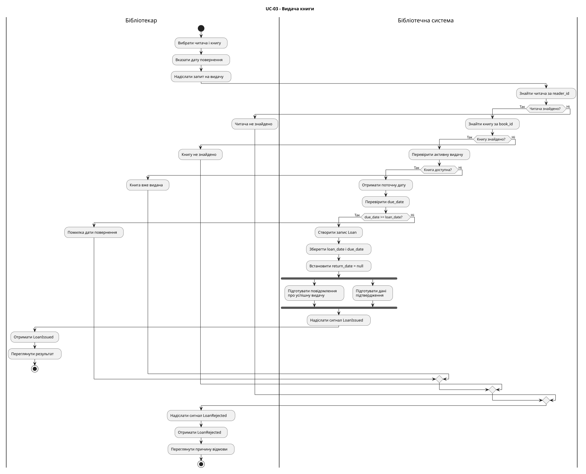

# Лабораторна робота №4 — Моделювання бізнес-процесу

## Тема

Моделювання процесу UC-03 «Видача книги» для бібліотечної системи.

## Мета роботи

Побудувати Activity-діаграму бізнес-процесу з використанням умовних переходів, паралельних дій, ролей та повідомлень між учасниками.

## Обрана нотація

**PlantUML Activity Diagram**

Ця нотація дозволяє показати весь процес видачі книги на одній діаграмі.

## Опис процесу

Бібліотекар вибирає читача, книгу та дату повернення.

Система перевіряє:

1. Чи існує читач.
2. Чи існує книга.
3. Чи немає активної видачі книги.
4. Чи правильна дата повернення.

Якщо перевірки успішні, система створює Loan і надсилає бібліотекарю повідомлення `LoanIssued`.

Якщо виникає помилка, система не створює Loan та надсилає повідомлення `LoanRejected`.

## Activity Diagram



Вихідний код: [book-loan-activity.puml](diagrams/book-loan-activity.puml).

## Сценарії

| Код | Сценарій |
|---|---|
| SC-01 | Успішна видача книги |
| SC-02 | Книга вже видана |
| SC-03 | Неправильна дата повернення |
| SC-04 | Читача не знайдено |

## Структура репозиторію

```text
lab4/
├── README.md
├── spec.md
├── DEFENSE.md
├── diagrams/
│   ├── book-loan-activity.puml
│   └── book-loan-activity.svg
└── ai/
    ├── 01-analysis-prompt.md
    ├── 02-audit-result.md
    └── 03-human-review.md
```

## AI-аудит

Для перевірки діаграми підготовлено:

- [Запит на аудит](ai/01-analysis-prompt.md)
- [Результати AI-аудиту](ai/02-audit-result.md)
- [Рішення за результатами аудиту](ai/03-human-review.md)

Під час аудиту розглянуто повноту переходів, умови, `fork/join`, повідомлення та відповідність попереднім лабораторним.

## Документація

- [Специфікація процесу](spec.md)
- [Захист лабораторної роботи](DEFENSE.md)

## Висновок

Побудовано Activity-діаграму видачі книги, яка об'єднує основний та альтернативні сценарії UC-03.

Діаграма містить ролі, розгалуження, паралельні дії та надсилання й отримання повідомлень.
